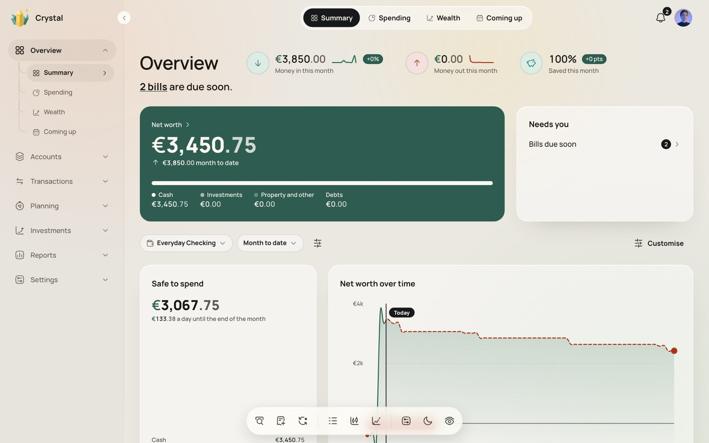
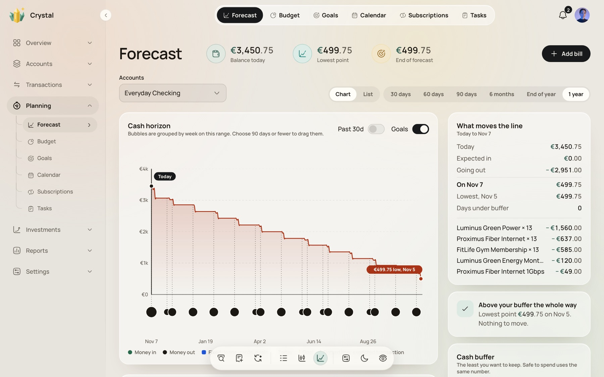
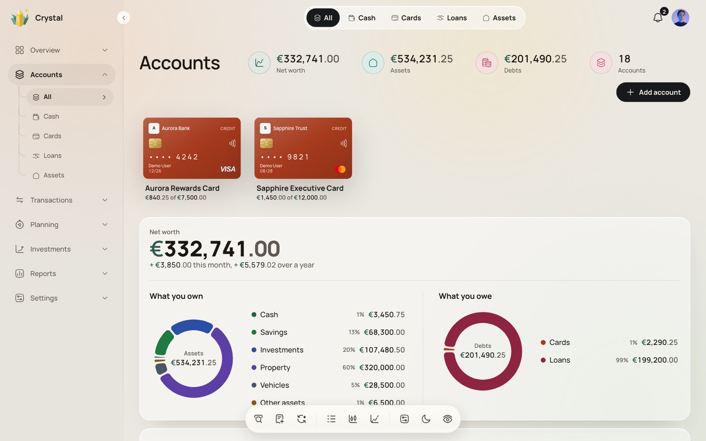
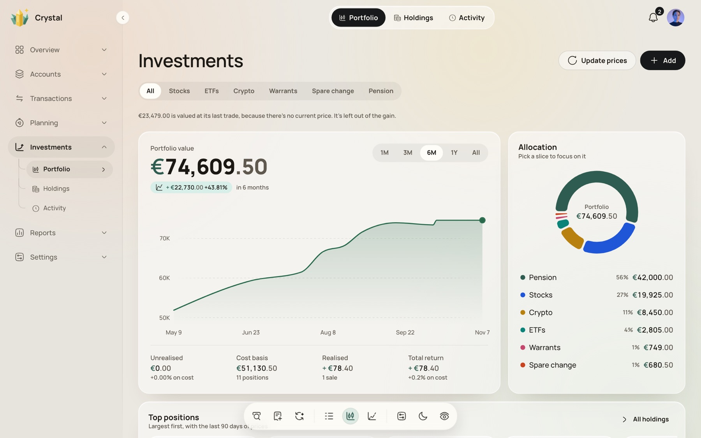

# Crystal 🔮

**Crystal** is the ultimate personal finance operating system. It moves beyond simple retrospective expense tracking to provide a professional-grade predictive wealth forecasting and financial simulation engine wrapped in a beautiful, **privacy-first, self-hosted** application.

Designed for data sovereignty, Crystal ensures your financial data remains yours while offering predictive capabilities typically found only in enterprise wealth management software. Crystal analyzes your historical financial velocity and merges it with expected future transactions to project your true liquidity, net worth, and cashflow trajectory up to 2 years ahead.



> **v3.0** is a full redesign with a new app shell, rebuilt Forecast, Accounts and Investments, a server-enforced PIN lock and multi-arch (amd64 + arm64) images. See the [changelog](CHANGELOG.md).

## 📸 Screenshots

| Forecast: cash horizon | Accounts: net worth |
| --- | --- |
|  |  |

| Investments: portfolio |
| --- |
|  |

*Screenshots use the built-in demo dataset.*

## 🌟 Key Features

- 🔮 **Forecast your cash, not just track it.** A deterministic simulation projects daily balances and net worth up to 2 years ahead from your history, scheduled bills, recurring income, loan amortisation and card statement cycles. It flags your lowest point before it happens and suggests a cash buffer.
- 🏦 **Everything in one place.** Cash, savings, cards, loans, mortgages, property, vehicles, investments, crypto, pensions, warrants and other assets or liabilities, in any of 150+ currencies (plus BTC), with live exchange-rate conversion.
- 🔒 **Yours alone.** Self-hosted with your own PostgreSQL. A server-enforced PIN lock, one-click privacy blur, rate-limited sign-in and encrypted bank credentials.
- 🤖 **Less manual work.** Bank sync, rules, merchant detection, duplicate and transfer matching, and subscription detection do the busywork.
- 📱 **Desktop and mobile.** Responsive layouts, keyboard shortcuts (⌘K command center, `N` to add), pull-to-refresh and swipe actions, light and dark themes.

---

## 🧭 What's inside

### 📊 Overview
* **Summary, Spending, Wealth and Coming up** tabs, each with size-responsive widgets you can rearrange and resize.
* Net worth with a cash / investments / property / debts breakdown, **Safe to spend** (a daily allowance until month end), money in/out/saved with period deltas, spending calendar, money-flow Sankey, goal rings and a "Needs you" card for bills and items to review.
* Spending map of where your money goes, drawn with MapLibre and OpenStreetMap (no API key).

### 💰 Accounts
* **Cash, Cards, Loans and Assets** views with per-type layouts and a wallet-style card view you can reorder by drag and drop.
* **Credit cards:** statement cycles, APR and fees, utilisation.
* **Loans and mortgages:** amortisation schedules, early repayments, deferred payments, bulk edits, future interest.
* **Property and vehicles:** valuation history, leases, mileage logs and limits, depreciation.
* Linked accounts, balance adjustments and reconciliation, closing assets, per-account analytics inclusion.

### 📝 Transactions
* Fast ledger with filters, bulk edit and bulk categorise, splitting and combining, transfers between accounts, and a **review queue** for imported items.
* Merchant logos, location tagging, a transaction scatter chart and a places map.
* **Import** from CSV with a guided mapping wizard and **export** to JSON or CSV.

### 🔮 Planning
* **Forecast:** cash-horizon chart and monthly ledger list, lowest-point marker, buffer suggestions, goal markers, and the items that move the line.
* **Budgets:** category budgets with exclusions, sub-goals and pace tracking.
* **Goals:** realistic completion dates from forward cashflow, monthly targets by account and month, and what-if scenarios.
* **Calendar and bills:** recurring transactions with overrides, bills and payments, automatic matching of bank transactions to scheduled items.
* **Subscriptions:** smart detection from your transactions, renewal timeline, monthly and annual commitment, plus a loyalty-card wallet.
* **Tasks:** a board and heatmap for follow-ups and chores.

### 📈 Investments
* **Portfolio, Holdings and Activity** with allocation by class, performance over time, realised and unrealised gain, cost basis and top positions.
* Stocks, ETFs and crypto with live prices via **Twelve Data**; **warrants and equity grants** with strike prices and vesting; **spare change** round-ups; **pension** tracking.
* Positions without a current price are valued at their last trade and left out of the gain, rather than guessed.

### 📑 Reports
* Spending velocity, category allocation, needs vs wants, merchant loyalty, budget vs actual, month-end forecast, anomaly and recurring-pattern detection, saved views and rule-based insights.

### 🧾 Quotes & invoices
* Create quotes and invoices with line items, tax and discounts, convert a quote to an invoice, and track the billing pipeline.

### 🕹️ Challenges
* A 0-100 **financial health score** from savings rate, liquidity and debt, day streaks, badges, savings sprints, spending predictions and personal records.

---

## 🔌 Integrations & automation

* **Enable Banking (beta):** connect 2,500+ European banks to import transactions and balances, with consent-expiry handling, re-authorisation, webhooks and a credential self-test. Bank sync never overwrites your manual edits.
* **Rules:** one rule model to categorise, tag and rename transactions automatically, with suggestions drawn from your history.
* **Merchant intelligence:** detect and profile merchants, fetch logos via **Brandfetch**, and manage branches and keyword rules.
* **Taxonomy:** hierarchical categories plus flat tags (`#trip`, `#project`) that cut across them.

## 🛠️ Data & security

* **Backup and restore:** export selected parts (accounts, transactions, taxonomy) as JSON or CSV, then restore by merging, with conflicts resolved by ID, or by replacing.
* **Sync safely across devices:** autosave with conflict detection and a three-way merge when two devices edit at once.
* **Security:** server-enforced PIN lock, session cookies, rate limiting, request validation, SSRF-guarded fetching and encrypted bank keys. See the [changelog](CHANGELOG.md) for what changed in 3.0.
* **Administration:** no email service is needed; admins reset passwords with a CLI, and registration can be switched off with `ALLOW_REGISTRATION=false`.
* **Preferences:** main currency, display currency, language, time zone, date format, financial-year start, default period, and a Settings search.

---

## Tech Stack
* **Frontend:** React 19, TypeScript, Vite, Tailwind CSS v4, React Aria Components, Motion.
* **Charts and maps:** visx (including Sankey), Recharts, MapLibre GL.
* **State and data:** Context API + TanStack Query; money maths with big.js.
* **Backend:** Express 4, PostgreSQL (one JSON document per user), zod validation.
* **Delivery:** Docker images for linux/amd64 and linux/arm64, Umbrel packaging.

## Installation

### Umbrel

Crystal is packaged for the Umbrel App Store (see [`crystal/`](crystal/)). It installs with its own PostgreSQL database and generated secrets; no configuration needed.

### Self-hosted (recommended)

Crystal is meant to run with its PostgreSQL backend via Docker:

```bash
export DATA_ROOT=./data JWT_SECRET="$(openssl rand -hex 32)" POSTGRES_PASSWORD="$(openssl rand -hex 16)"
docker compose up -d
```

Then open `http://localhost:7157`. Images are published for `linux/amd64` and `linux/arm64`; pin `backend-v3.0.0` / `frontend-v3.0.0` in `docker-compose.yml` for a fixed version. `JWT_SECRET` (a long random value; it signs session tokens) and `POSTGRES_PASSWORD` are required — the stack and the production server refuse to start without them.

### Local development

```bash
npm install
npm run dev
```

`npm run dev` serves the app on `http://localhost:3000` (loopback only; set `HOST` to change it).
It needs an API backend:

- **Real backend:** run `server/` (see `server/package.json`) and set `VITE_BACKEND_URL=http://localhost:3001`.
- **In-memory mock (UI work only):** `CRYSTAL_MOCK_API=1 npm run dev`. Data is lost on restart, the sample user
  is `demo@crystal.app` / `password`, and it must never be exposed to a network.

### Resetting a password

Crystal has no email service, so an administrator resets passwords from the server:

```bash
docker compose exec backend node dist/cli/reset-password.js user@example.com
```

A random password is printed (pass a second argument to choose one). All of that user's sessions are signed out.

### Tests

```bash
npm test               # unit tests
tests/run-all.sh       # unit tests + Playwright e2e against a throwaway Postgres
```

## License
MIT