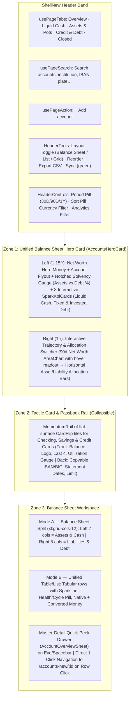
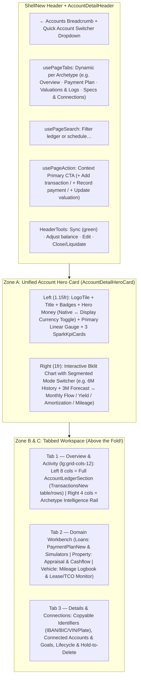

# Accounts & Account Detail — Vanilla First-Principles Redesign Plan (`AccountsNew` & `AccountDetailNew`)

**Target Routes:** `/accounts-new` (`AccountsNew`) and `/accounts-new/:id` (`AccountDetailNew`)  
**Design Authority:** [UI_UX_DESIGN_REFERENCE.md](file:///Users/samerberjawi/Documents/Crystal/UI_UX_DESIGN_REFERENCE.md) (§18/N1–N19 > §17 > §11/R1–R9 > §10/D1–D16 > §7/Q1–Q12)  
**Reference Benchmark:** [TransactionsNew.tsx](file:///Users/samerberjawi/Documents/Crystal/pages/new/TransactionsNew.tsx) & [overview.tsx](file:///Users/samerberjawi/Documents/Crystal/components/new/transactions/overview.tsx)  
**Design Philosophy:** A **complete vanilla redesign from first principles** — discarding the fragmented classic layouts, 9 copy-pasted detail templates, and 2-click navigation traps, while preserving 100% of capabilities and fixing **15 concrete calculation, currency, sign, and data-flow bugs** uncovered in the classic codebase.

---

## 1. Why Start Fresh: Problems with the Classic Design & Codebase

### 1.1 UX & Structural Anti-Patterns Being Discarded
1. **The 2-Click Modal Trap on Accounts List**: In classic [Accounts.tsx](file:///Users/samerberjawi/Documents/Crystal/pages/Accounts.tsx#L279-L286), clicking an account card did **not** open the account—it opened `AccountOverviewModal`, forcing a second click on *"View Full Details"* to reach `AccountDetail`.
2. **9 Disconnected, Copy-Pasted Detail Layouts**: Classic `AccountDetail` dispatched to 9 separate 400–650 line files (`GeneralAccountView`, `SavingsAccountView`, `CreditCardAccountView`, `CashAccountView`, `LoanAccountView`, `PropertyAccountView`, `VehicleAccountView`, `PensionAccountView`, `SpareChangeAccountView`). Each file duplicated its own mobile header, desktop header, glowing-orb `MetricTile` component, and arbitrary card heights (`min-h-[460px] rounded-[3rem]`), placing charts, ledgers, and metadata in completely different positions on every account type.
3. **Endless Vertical Scroll on Detail Pages**: Classic detail pages stacked a massive hero row, a 4-KPI row, 1–2 full-width charts, an amortization or mileage table, and finally the transaction ledger 1,500px below the fold.
4. **Garish Gradient Card Walls**: Classic `AccountRow` painted every checking account indigo, every savings account emerald, and every credit card dark slate, violating the calm flat-tile language (`R2`, `R9`).

---

## 2. Logic & Math Audit: 15 Bugs Fixed in the Redesign

During the audit of [Accounts.tsx](file:///Users/samerberjawi/Documents/Crystal/pages/Accounts.tsx), [AccountDetail.tsx](file:///Users/samerberjawi/Documents/Crystal/pages/AccountDetail.tsx), [utils.ts](file:///Users/samerberjawi/Documents/Crystal/utils.ts), and the 9 classic account views, we identified **15 logic and calculation bugs** that will be fixed in `utils/accountsModel.ts` and `utils/accountDetailModel.ts`:

| Bug ID | Location in Classic Code | Root Cause / Bug Description | Fix in `accountsModel.ts` / `accountDetailModel.ts` |
| :--- | :--- | :--- | :--- |
| **BUG-01** | [Accounts.tsx:86](file:///Users/samerberjawi/Documents/Crystal/pages/Accounts.tsx#L86) vs [L136](file:///Users/samerberjawi/Documents/Crystal/pages/Accounts.tsx#L136) & [AccountDetail.tsx:419](file:///Users/samerberjawi/Documents/Crystal/pages/AccountDetail.tsx#L419-L424) | **Orphaned Pension/Spare Change Accounts & Dead `invested` Segment**: `visibleAccounts` strips all `acc.type === 'Investment'`, making `activeSegment === 'invested'` (`lines 136, 183, 235`) dead code that always evaluates to `0`. Worse, `Pension Fund` and `Spare Change` accounts created via `AddAccountModal` immediately vanish from the Accounts page! | Include `Investment` accounts with `subType === 'Pension Fund'` or `'Spare Change'` (and cash/savings-like pots) directly in `AccountsNew`, and remove dead unreachable segment branches. |
| **BUG-02** | [Accounts.tsx:108-125](file:///Users/samerberjawi/Documents/Crystal/pages/Accounts.tsx#L108-L125), [AccountRow.tsx:89-111](file:///Users/samerberjawi/Documents/Crystal/components/AccountRow.tsx#L89-L111), [HistoricalBalanceTrend.tsx:98-109](file:///Users/samerberjawi/Documents/Crystal/components/HistoricalBalanceTrend.tsx#L98-L109) | **Future-Dated Transactions Corrupt Historical Curve**: `account.balance` includes future-dated transactions, yet the 90d/180d backward loop starts at `today` (`runningBal = account.balance`) without first backing out transactions where `tx.date > today`. | Compute `realTodayBalance` first by subtracting any transactions dated `> todayIso` before walking backward day-by-day. |
| **BUG-03** | [AccountRow.tsx:113](file:///Users/samerberjawi/Documents/Crystal/components/AccountRow.tsx#L113) | **Sparklines Clamped to `0` for Liabilities & Overdrafts**: `Math.max(0, item.value)` flattens every negative balance (`Credit Card`, `Loan`, `Other Liabilities`, overdrawn `Checking`) to a dead `0 → 0` flat line with `trend = 0`. | Never clamp negative balances to `0`. For liability accounts, plot debt magnitude or signed balance and set `good="down"` so debt reduction renders green. |
| **BUG-04** | [Accounts.tsx:103-125](file:///Users/samerberjawi/Documents/Crystal/pages/Accounts.tsx#L103-L125) | **Broken 90d Net Worth Reconstruction**: Starts from `calculateAccountTotals` (which uses loan amortization schedules) and subtracts raw `analyticsTransactions`, ignoring `Property`/`Vehicle` `priceHistory` appraisal dates and miscounting loan principal/interest payments. | Reconstruct daily historical Net Worth per account using: (a) ledger deltas for cash/cards, (b) `priceHistory` step valuations for Property/Vehicle, and (c) scheduled loan principal state as of each date. |
| **BUG-05** | [Accounts.tsx:172-181](file:///Users/samerberjawi/Documents/Crystal/pages/Accounts.tsx#L172-L181) | **90-Day Sum Mislabeled as `"30d Net Flow"`**: `thirtyDaysAgo.setDate(thirtyDaysAgo.getDate() - 90)` sums 90 days of transactions but labels the metric `"30d Net Flow"`. | Bind all flow metrics strictly to the active period pill (`MTD`, `30D`, `90D`, `1Y`) so window and label always match. |
| **BUG-06** | [HistoricalBalanceTrend.tsx:119-137](file:///Users/samerberjawi/Documents/Crystal/components/HistoricalBalanceTrend.tsx#L119-L137) | **Single-Account Forecast Drops Linked Loan & Credit Card Settlements**: Passing `[account]` (only the Checking account) to `generateSyntheticLoanPayments([account])` and `generateSyntheticCreditCardPayments([account])` produces `[]` because the linked `Loan` and `Credit Card` objects aren't in the array! Checking forecasts therefore miss all mortgage and card auto-pay outflows. | Pass the full `accounts` list into synthetic generator functions so linked settlement transfers are generated, then filter the resulting forecast series to `account.id`. |
| **BUG-07** | [HistoricalBalanceTrend.tsx:164-165](file:///Users/samerberjawi/Documents/Crystal/components/HistoricalBalanceTrend.tsx#L164-L165), [SavingsAccountView.tsx:128](file:///Users/samerberjawi/Documents/Crystal/components/SavingsAccountView.tsx#L128), [GeneralAccountView.tsx:136](file:///Users/samerberjawi/Documents/Crystal/components/GeneralAccountView.tsx#L136) | **Cross-Currency Addition Without Conversion**: `generateBalanceForecast` outputs `EUR` values, which `HistoricalBalanceTrend` adds directly to `account.balance` (even if the account is `USD`, `GBP`, or `RON`). Likewise, `SavingsAccountView` and `GeneralAccountView` subtract raw `tx.amount` without converting `tx.currency` → `account.currency`. | Normalize all per-account math into `account.currency` via `convertCurrency(tx.amount, tx.currency, account.currency, rates)` before summing. |
| **BUG-08** | [utils.ts:1419-1429](file:///Users/samerberjawi/Documents/Crystal/utils.ts#L1419-L1429) | **Loan Schedule Overwrites Multiple Same-Month Payments & Drops Non-Transfer Payments**: `paymentMap.set(monthYear, p)` keeps only the *last* transaction in a given `YYYY-MM`, silently discarding bi-weekly or extra payments in the same month, and requires `tx.transferId` (ignoring direct loan payments). | Group and sum all valid loan payments within each `YYYY-MM` bucket (both transfer-linked and direct payments) when building the amortization schedule. |
| **BUG-09** | [utils.ts:1477-1584](file:///Users/samerberjawi/Documents/Crystal/utils.ts#L1477-L1584) | **`override.extraPrincipal` Is Never Applied to Loan Math**: `generateAmortizationSchedule` copies `extraPrincipal: override?.extraPrincipal` onto the output object (`line 1581`) but **never subtracts it from `outstandingBalance`**! Extra principal overrides have zero effect on payoff or interest. | Subtract `override?.extraPrincipal || 0` from `outstandingBalance` in that period, recalculating all subsequent interest and shortening the payoff schedule. |
| **BUG-10** | [PropertyAccountView.tsx:82,105](file:///Users/samerberjawi/Documents/Crystal/components/PropertyAccountView.tsx#L82-L107) vs [VehicleAccountView.tsx:184](file:///Users/samerberjawi/Documents/Crystal/components/VehicleAccountView.tsx#L184) | **Asymmetric Asset↔Loan Link & Refinance Purchase Price Corruption**: `VehicleAccountView` ignores `account.linkedLoanId` (only checking `loan.linkedAssetId`). And `PropertyAccountView:105` overwrites `account.purchasePrice` with `linkedLoan.principalAmount + downPayment`, fabricating fake appreciation when a mortgage is refinanced. | Use a unified bidirectional link resolver (`findLinkedLoan` / `findLinkedAsset`), and always prioritize explicit `account.purchasePrice` over inferred loan principal. |
| **BUG-11** | [VehicleAccountView.tsx:206-238](file:///Users/samerberjawi/Documents/Crystal/components/VehicleAccountView.tsx#L206-L238) | **Vehicle Mileage Ignores `account.currentMileage` & Lease Pace Assumes `0 km` Start**: Returns `0 km` when `mileageLogs` is empty even if `account.currentMileage` is set; assumes odometer was `0` at lease start; and does not clamp `elapsedDays` when a lease has ended or hasn't started yet. | Fall back to `account.currentMileage`; compute lease distance driven relative to start-of-lease odometer; clamp `elapsedDays` to `[0, totalDays]`. |
| **BUG-12** | [CashAccountView.tsx:83,139](file:///Users/samerberjawi/Documents/Crystal/components/CashAccountView.tsx#L83-L145) | **Cash Burn-Rate Divides MTD Spend by 30**: Sums `totalOutflow` since the 1st of the current month (`startOfMonth`), then divides by `30` instead of elapsed days in the month or a rolling 30-day window. On day 1 of a month, burn rate is under-reported by 30×. | Compute daily burn rate and runway from a true **rolling 30-day window** (`today - 29d` → `today`, divided by `30`). |
| **BUG-13** | [CreditCardAccountView.tsx:92-115](file:///Users/samerberjawi/Documents/Crystal/components/CreditCardAccountView.tsx#L92-L115) | **Credit Card Metrics Ignore Statement Cycle & Mishandle Positive Credit Surplus**: Uses `startOfMonth` instead of the card's `statementStartDate` cycle, and when `account.balance > 0` (refund/credit surplus), `utilization` becomes negative (`-5%`). | Drive cycle spend/payments from `calculateStatementPeriods`, clamp `utilization` to `[0, 100+]`, and show a `Credit surplus` badge when `balance > 0`. |
| **BUG-14** | [PensionAccountView.tsx:96-116](file:///Users/samerberjawi/Documents/Crystal/components/PensionAccountView.tsx#L96-L116) | **Mixed Currencies (`preferredCurrency` vs `EUR`) & Simple Return Labeled as "Annualized"**: Subtracts `contributions` (summed from `convertedAmount` in `preferredCurrency`) from `currentBalanceEur` (in `EUR`), corrupting growth whenever `preferredCurrency !== 'EUR'`, and labels all-time simple return (`growth / contributions`) as "Annualized Return". | Perform all pension math in a single currency and compute both Cumulative Return % and true time-weighted / CAGR Annualized Return %. |
| **BUG-15** | [SpareChangeAccountView.tsx:97-105](file:///Users/samerberjawi/Documents/Crystal/components/SpareChangeAccountView.tsx#L97-L105) | **Manual Deposits Counted as Round-Ups**: Counts every `income` transaction as a round-up, so a €500 manual transfer inflates `avgRoundUp` and reports `Biggest Round-Up: €500`. | Separate micro round-up captures (`tx.isRoundUp` or `< 10` unit round-ups) from manual lump-sum deposits so round-up stats stay accurate. |

---

## 3. Vanilla Redesign of `/accounts-new` (`AccountsNew`) — The Balance Sheet Cockpit

Designed from scratch to match the visual standard of [TransactionsHeroCard](file:///Users/samerberjawi/Documents/Crystal/components/new/transactions/overview.tsx#L351-L678) in `TransactionsNew`:

### 3.1 Zone 1: `AccountsHeroCard` (Unified Balance Sheet Hero)
Instead of a separate dark banner + detached KPI row, `AccountsHeroCard` is a single flat `Card` (`p-4 sm:p-5 lg:p-6`) with a **2-column asymmetric split (`lg:grid-cols-[minmax(0,1.15fr)_minmax(0,1fr)]`)** directly echoing `TransactionsHeroCard`:

- **Left Column (`1.15fr`)**:
  1. **Top Row**:
     - Eyebrow label (`Total net worth` on `Overview`, or `Liquid cash`, `Assets & pots`, `Total debt` when filtered to a segment) + interactive **Account Breakdown Flyout pill** (`Across N accounts ▾` — clicking opens a flyout listing accounts with quick filter toggles).
     - Hero figure: `<Money amount={netWorth} currency={displayCurrency} size="hero" />`.
     - Right badge: Period change pill (`<Delta pct={netWorthDeltaPct} good="up" />` + absolute `<Money signed />` change over the selected period `30D`/`90D`/`1Y`).
  2. **Middle Row — Notched Solvency & Leverage Gauge (`Gauge orientation="linear"`)**:
     - Uses the same Bklit `Gauge` (`totalNotches={54}`, `CRYSTAL_FLOW_GRADIENTS`) as `TransactionsHeroCard` to visualize **Assets (`%` green) vs Liabilities (`%` red/orange)**, plus a muted caption (`Debt-to-Asset ratio: X% · Liquid runway: ~Y months`).
  3. **Bottom Row — 3 Interactive `SparkKpiCard` SubCards (`grid-cols-3 gap-2 sm:gap-3`)**:
     - Each `SparkKpiCard` has a colored status dot, label, `<Delta />`, `<Money />`, and a 40px interactive `AreaSparkline` (`useSparklineHover`):
       - **Card 1: `Liquid Cash`** (`dot: bg-nv-green`, `chartColor: var(--nv-green)`, Checking + Savings + Physical Cash). Clicking filters the workspace to `Liquid Cash`.
       - **Card 2: `Assets & Pots`** (`dot: bg-nv-violet`, `chartColor: var(--nv-violet)`, Property + Vehicle + Lending + Pension + Spare Change + Other Assets). Clicking filters to `Assets & Pots`.
       - **Card 3: `Liabilities`** (`dot: bg-nv-red`, `chartColor: var(--nv-red)`, `good="down"`, Credit Cards + Loans + Other Liabilities). Clicking filters to `Credit & Debt`.

- **Right Column (`1fr`)**:
  - **Header**: Title (`Net worth trajectory` or `Portfolio allocation`) + **Segmented Mode Toggle (`Trajectory` | `Allocation` | `Attention`)**:
    - **`Trajectory` Mode (Default)**: Interactive Bklit `AreaChart` (`height={210}`) showing daily net worth over the selected period (`30D` / `90D` / `1Y`) with crosshair hover readout.
    - **`Allocation` Mode**: Clean horizontal stacked breakdown bar + interactive legend pills showing exact `%` and `<Money>` share per account category (`Checking`, `Savings`, `Real Estate`, `Vehicles`, `Retirement & Pots`, `Credit Cards`, `Loans`). Clicking any category filters the list below.
    - **`Attention` Mode (Smart Insights Strip)**: Surfaces actionable alerts across accounts:
      - Credit cards with statement payment due within 7 days or utilization `> 70%`.
      - Checking accounts where `safeToSpend < 0` in the next 14 days.
      - Leased vehicles currently `Over Allowance` pace.
      - Linked Enable Banking accounts whose PSD2 consent expires soon or need syncing.

### 3.2 Zone 2: Collapsible "Cards & Passbooks" Rail (`CardWalletRail`, Q6)
- Rendered in a clean flat container with a header bar (`Cards & Passbooks · N` + `Collapse / Expand` toggle saved in local state).
- Uses `MomentumRail` (`components/kokonutui/momentum-rail.tsx`) + `CardFlip` (`components/kokonutui/card-flip.tsx`):
  - **Front of Card**: Flat `bg-nv-surface border border-nv-line rounded-nv-card p-5` (no raw gradient fills per R9), Brandfetch `LogoTile`, account name, `Primary`/`Synced` badge, `<Money size="xl" />` balance, masked `•••• 4821` or formatted IBAN tail (`•• 8901`), network glyph (`Visa`/`Mastercard`/`Amex`), mini utilization bar (for Credit Cards) or APY pill (for Savings), and an accessible top-right **Flip** button.
  - **Back of Card**:
    - *Credit Card*: Credit limit, Available credit, Utilization %, Statement close day, Payment due date countdown, Auto-pay settlement account name, and `Open card →` button.
    - *Checking / Savings*: Full copyable `IBAN` and `BIC` buttons (`toast.success('Copied IBAN')`), APY %, 30d net flow, and `Open account →` button.

### 3.3 Zone 3: The Balance Sheet Workspace (Solving the 2-Click Trap)
- **Navigation Model**:
  - **1-Click Primary Navigation**: Clicking an account row or card navigates **immediately** to `/accounts-new/:id` (`AccountDetailNew`).
  - **Quick-Peek Drawer (`AccountOverviewSheet`)**: Clicking the quick-peek icon button (`eye`) on the right of any row—or pressing `Space` while keyboard-navigating rows—opens `AccountOverviewSheet` on the right without leaving `/accounts-new`. While the sheet is open, clicking other rows or pressing `↑`/`↓` updates the sheet live (true master-detail inspection!).
- **Three Switchable Workspace Layouts (`<HeaderTools>`)**:
  1. **Balance Sheet Split (`xl:grid-cols-12`, Default on `Overview`)**:
     - Left Column (`xl:col-span-7`): **Assets & Liquidity** grouped into collapsible `Card` sections (`Liquid Cash`, `Savings & Reserves`, `Real Estate & Vehicles`, `Retirement & Micro-Savings`, `Receivables & Other`).
     - Right Column (`xl:col-span-5`): **Liabilities & Credit** grouped into collapsible `Card` sections (`Credit Cards`, `Loans & Mortgages`, `Other Liabilities`), plus a **Net Equity Summary Footer** (`Total Assets − Total Debt = Net Worth`).
  2. **Unified Table (`AccountTable` on `lg+`)**:
     - Dense, sortable tabular view (matching `TransactionTable` in `TransactionsNew`):
       - Columns: `Account & Institution`, `Type / Identifier`, `Status / Health` (utilization bar, loan payoff %, APY %, lease pace), `90d Trend` (`Sparkline` + `<Delta />`), `Balance` (native + converted `<Money>`), and `Actions` (`Quick peek`, `Add tx`, `•••` menu).
  3. **Bento Grid**:
     - Responsive 3-column grid of `AccountCardNew` tiles with manual drag-and-drop + keyboard reorder (`toast.undo('Reordered accounts', undo)`).

---

## 4. Vanilla Redesign of `/accounts-new/:id` (`AccountDetailNew`) — Unified Cockpit + 5 Archetype Engines

Instead of 9 unrelated page files, **every account detail page** uses a single, cohesive **3-Zone Cockpit Architecture** (`pages/new/AccountDetailNew.tsx`), where the layout grid, header, hero card structure, and ledger are 100% consistent, and each account type plugs in its **Archetype Engine**:

### 4.1 Quick Account Switcher in Detail Header
- At the top of `AccountDetailNew`, next to `← Accounts`, clicking the current account's pill opens a **Quick Account Switcher popover** (just like the account flyout in `TransactionsHeroCard`), letting the user jump directly from e.g. *Main Checking* → *Visa Platinum* or *Home Mortgage* in 1 click without going back to the list page.

### 4.2 How the 5 Financial Archetypes Map Across All 10 Account Types

Every account type renders inside the **Unified Cockpit**, configured by its Archetype Engine:

---

#### Archetype 1: Liquid & Operating Accounts (`Checking`, `Physical Cash`, generic `Other Assets` / `Other Liabilities`)
*Covers classic `GeneralAccountView` and `CashAccountView` — unified into a single clean operating engine with Cash-specific reserve intelligence when `otherSubType === 'Cash'`.*

- **Zone A — Hero Card (`AccountDetailHeroCard`)**:
  - **Hero Figure**: `Real Today Balance` (`<Money size="hero" />`, excluding future-dated transactions per **BUG-02**) + `<Delta />` vs 90d ago.
  - **Primary Linear Gauge (`Gauge orientation="linear"`)**:
    - *Checking*: **Liquidity Commitment Bar** — `Safe to Spend` (green) vs `Committed Outflows Next 14d` (orange: scheduled bills, recurring expenses, linked credit card auto-pay, and linked loan installments).
    - *Physical Cash*: **Cash Reserve Runway Gauge** — shows days of runway (`~N days runway` based on true rolling 30d burn rate per **BUG-12**) with status badge (`Robust`, `Moderate`, `Low Reserve`).
  - **3 `SparkKpiCard` Tiles**:
    1. **Safe to Spend (14d)** (or **30d Replenished** for Physical Cash) — `<Money />` + sparkline.
    2. **30d Lowest Forecast** (or **30d Expended** for Physical Cash) — minimum projected balance over the next 30 days (with full linked-account synthetic events per **BUG-06**).
    3. **Monthly Spend Velocity** (or **Daily Burn Rate** for Physical Cash) — 90d rolling average outflow.
  - **Right Column Interactive Chart (Segmented Switcher)**:
    - **View 1: `Balance & 90d Forecast`** — Bklit `LineChart` showing 6M historical daily balance (solid) + 3M projected balance (`dashFromIndex` dashed line, with currency normalization per **BUG-07**).
    - **View 2: `6M Inflow vs Outflow`** — Bklit grouped `BarChart` comparing monthly inflows vs outflows.
- **Zone B — Right Intelligence Rail (alongside `AccountLedgerSection`)**:
  - **Upcoming 14-Day Obligations Card**: Chronological list of upcoming bills, recurring items, credit card settlements, and loan installments hitting this account, with a running balance column so the user sees *when* a dip happens.
  - **Quick Cash Reconciliation Card** (for Physical Cash): 1-click *"Count wallet cash"* button opening `BalanceAdjustmentSheet`.
  - **Connected Accounts & Goals**: Linked credit cards using this account for settlement, linked loans, and linked savings goals.

---

#### Archetype 2: Yield, Compounding & Micro-Savings Pots (`Savings`, `Pension Fund`, `Spare Change`)
*Covers classic `SavingsAccountView`, `PensionAccountView`, and `SpareChangeAccountView` — unified around yield, contributions, and future compounding.*

- **Zone A — Hero Card (`AccountDetailHeroCard`)**:
  - **Hero Figure**: Current Pot / Savings Balance `<Money size="hero" />` + `APY %` badge (`green`) + `<Delta />`.
  - **Primary Linear Gauge (`Gauge orientation="linear"`)**:
    - *Savings*: **Linked Goals Funding Progress %** (how much of linked financial goals is covered by this savings balance).
    - *Pension Fund*: **Retirement Accumulation Index %** (`Current Pot` vs `Projected Pot at Retirement Year`, fixing **BUG-14**).
    - *Spare Change*: **Milestone & Coffee Index Bar** (`≈ N Specialty Coffees saved` at `€4.50` + progress to next €100 milestone).
  - **3 `SparkKpiCard` Tiles**:
    - *Savings*: (1) **Est. Annual / Monthly Yield** (`balance × apy`), (2) **YTD Interest Earned** (actual interest transactions), (3) **Net Savings Rate (90d)**.
    - *Pension Fund*: (1) **Projected at Retirement (`retirementYear`)**, (2) **Total Yield Growth** (CAGR % + cumulative return above principal, single-currency normalized per **BUG-14**), (3) **Monthly Contribution Velocity (12m)**.
    - *Spare Change*: (1) **True Round-Up Captures** (count & sum of micro round-ups, separated from manual deposits per **BUG-15**), (2) **Avg & Peak Round-Up**, (3) **MTD Intake**.
  - **Right Column Interactive Chart (Segmented Switcher)**:
    - *Savings*: **`12M Yield (Actual vs Projected APY)`** (`BarChart`) ↔ **`Balance & Compounding Curve`** (`AreaChart`).
    - *Pension Fund*: **`Fortune Trajectory to Retirement`** (`LineChart` plotting historical balance, cumulative principal contributions, and dashed compound curve to `retirementYear`) ↔ **`Annual Contributions vs Growth`** (`BarChart`).
    - *Spare Change*: **`6M Round-Up Pulse`** (`BarChart` of monthly round-ups vs manual top-ups) ↔ **`Balance Growth`** (`AreaChart`).
- **Zone B — Right Intelligence Rail**:
  - **Interactive Compounding / "What-If" Estimator Card**: A clean slider/input inside a flat `SubCard` where the user can tweak **Monthly Contribution (`+€X/mo`)** or **APY (`Y%`)** and immediately see the delta on their 1Y / 5Y / Retirement pot!
  - **Linked Goals / Automation Source Card**: Shows linked `FinancialGoal` progress bars (for Savings) or the linked funding `Checking` account (for Spare Change).

---

#### Archetype 3: Revolving Credit (`Credit Card`)
*Replaces classic `CreditCardAccountView` with a true statement-cycle billing engine.*

- **Zone A — Hero Card (`AccountDetailHeroCard`)**:
  - **Hero Figure**: Current Balance Owed `<Money size="hero" />` (or green `Credit Surplus` badge if `balance > 0` per **BUG-13**) + Credit Limit subtitle (`of €X,XXX limit`).
  - **Primary Linear Gauge (`Gauge orientation="linear"`)**:
    - **Credit Utilization Gauge**: `Used %` vs `Available Credit`, with semantic threshold indicator (`<30% Optimal` green, `30–70% Elevated` orange, `>70% High` red).
  - **3 `SparkKpiCard` Tiles (Driven by Active Statement Cycle per BUG-13)**:
    1. **Current Cycle Spend**: Spend accumulated since `currentPeriod.start` (`orange` dot + daily spend sparkline).
    2. **Cycle Repayments**: Payments credited in the current cycle (`green` dot).
    3. **Available Credit Headroom**: `<Money amount={availableCredit} />` (`sky` dot).
  - **Right Column Interactive Visual (Segmented Switcher)**:
    - **View 1: `Statement Spend Velocity (6M)`** — Bklit `BarChart` comparing monthly statement spend vs repayments.
    - **View 2: `Balance & Settlement Forecast`** — `HistoricalBalanceTrendNew` showing the upcoming auto-pay settlement drop on `paymentDue`.
    - **View 3: `Interactive Card`** — Full KokonutUI `CardFlip` showing card front & back (copyable card details, network logo, expiry).
- **Zone B — Right Intelligence Rail**:
  - **Statement Billing Cycle Engine Card**:
    - Visual timeline of **Previous Statement** (`Paid` green badge or `Unpaid: €X due on Date` with 1-click **`Record Payment`** CTA that opens the transfer composer pre-filled from `settlementAccountId` for the exact unpaid statement balance!) → **Current Statement** (`Closes in N days · Day X`) → **Payment Due Date** (`Day Y`).
    - Clickable link to the **Auto-Pay Settlement Account** (`Checking`).
  - **Ledger Cycle Filter Pills**: Top of `AccountLedgerSection` includes 1-click cycle pills: `Current Statement`, `Previous Statement`, `All Activity`.

---

#### Archetype 4: Amortizing Debt & Receivables (`Loan` & `Lending`)
*Replaces classic `LoanAccountView`, `PaymentPlanTable`, and `MortgageAmortizationChart`.*

- **Dual-Mode Semantics**: Automatically switches terminology and sign conventions between **Borrower mode (`Loan`)** and **Lender mode (`Lending`)**.
- **Zone A — Hero Card (`AccountDetailHeroCard`)**:
  - **Hero Figure**: Total Remaining Principal `<Money size="hero" />` + `APR %` and `Target Payoff Date` badges (dynamically updated when extra principal or deferrals are applied per **BUG-09**!).
  - **Primary Linear Gauge (`Gauge orientation="linear"`)**:
    - **Principal Payoff Gauge**: `Principal Repaid %` (`green`) vs `Remaining Principal %` (`violet`), plus a secondary breakdown pill (`Future Scheduled Interest: €X`).
  - **3 `SparkKpiCard` Tiles**:
    1. **Principal Cleared**: `<Money amount={totalPaidPrincipal} />` (`green` dot, `X% of original principal`).
    2. **Cumulative Interest Paid / Earned**: `<Money amount={totalPaidInterest} />` (`orange` dot).
    3. **LTV & Asset Equity** (when linked to a `Property` or `Vehicle` via bidirectional resolver per **BUG-10**, otherwise **Remaining Installments Count & Monthly Cost**).
  - **Right Column Interactive Chart (Segmented Switcher)**:
    - **View 1: `Yearly Amortization (Principal vs Interest)`** — Bklit stacked `BarChart` showing how principal share grows and interest shrinks each year.
    - **View 2: `Payoff Balance Curve`** — Bklit `AreaChart` showing remaining balance trajectory to `0` (comparing original baseline curve vs accelerated curve when `extraPrincipal` overrides exist!).
- **Workspace Tabs (`usePageTabs`)**:
  - **Tab 1: `Overview & Activity`**:
    - Left (`8 cols`): `AccountLedgerSection` showing recorded loan payments + `+ Record payment` button.
    - Right (`4 cols`):
      - **Next Installment Card**: Due date, total payment, principal vs interest split, and 1-click **`Pay Installment #N`** button (opens pre-filled transfer from `linkedAccountId`).
      - **Interactive Early Payoff Simulator Card**: Inline calculator where typing a **One-time Lump Sum** or **Recurring Extra Monthly Payment** immediately previews **Total Interest Saved (`€X`)** and **Time Saved (`Y months earlier`)**, with an `Apply to schedule` button (with `toast.undo`).
      - **Linked Financed Asset Card**: Shows the linked `Property` or `Vehicle` with its current market value, LTV %, net equity, and 1-click jump link.
  - **Tab 2: `Payment Plan · N` (`PaymentPlanNew`)**:
    - Full-width interactive amortization table (`lg+`) / card list (`<lg`) fixing **BUG-08** and **BUG-09**:
      - Filter pills: `All (N)`, `Paid`, `Upcoming`, `Overdue`, `Deferred / Modified`.
      - Toolbar actions: `Add Early Lump Sum`, `Defer Installments` (`LoanDeferPaymentSheet`: `'full'` holiday vs `'interest_only'`), `Bulk Override Schedule` (`LoanBulkEditSheet`), `Reset Overrides` (with Undo), and `Export Schedule CSV`.
      - Each installment row supports inline editing of `totalPayment`, `principal`, `interest`, or `extraPrincipal` with instant schedule recalculation and `toast.undo`.

---

#### Archetype 5: Physical & Appraising Assets (`Property` & `Vehicle`)
*Replaces classic `PropertyAccountView`, `VehicleAccountView`, `PropertyValuationModal`, and `AddMileageLogModal`.*

- **Zone A — Hero Card (`AccountDetailHeroCard`)**:
  - **Identity Header**:
    - *Property*: Property type glyph, street address pill, size `m²` & rooms summary.
    - *Vehicle*: Brandfetch Car Make `LogoTile` (`CAR_MAKE_DOMAINS`), `Year Make Model`, fuel & ownership badges (`Owned` vs `Leased`), and a clean EU **`LicensePlateNew`** badge (`countryCode` + monospace plate).
  - **Hero Figure**: Current Estimated Market Value `<Money size="hero" />` + `<Delta />` appreciation/depreciation vs Purchase Price (always using explicit `purchasePrice` first per **BUG-10**).
  - **Primary Linear Gauge (`Gauge orientation="linear"`)**:
    - *Property & Owned Vehicle*: **Equity vs Debt Bar** — `Net Equity %` (`green`) vs `Linked Mortgage/Loan Balance %` (`orange`).
    - *Leased Vehicle*: **Lease Contract & Mileage Allowance Bar** — compares `Contract Time Elapsed %` against `Total Mileage Allowance Used %` (corrected for initial odometer and clamped to contract dates per **BUG-11**).
  - **3 `SparkKpiCard` Tiles**:
    - *Property*: (1) **Net Property Equity** (`Market Value − Mortgage Principal`), (2) **Capital Appreciation** (`Market Value − Purchase Price` & `%`), (3) **Net Annual Holding Cashflow** (`Rental Income − Tax − Insurance − HOA`).
    - *Vehicle*: (1) **Current Odometer & Pace** (`124,500 km` + `avg km/day`, falling back to `account.currentMileage` per **BUG-11**), (2) **Net Vehicle Equity / Lease Remaining**, (3) **Total Cost of Ownership (TCO / km)** (sums fuel, service, insurance, tax, and depreciation divided by distance driven!).
  - **Right Column Interactive Chart (Segmented Switcher)**:
    - *Property*: **`Valuation & Equity Curve`** (`AreaChart` plotting `priceHistory` appraisals vs remaining mortgage debt) ↔ **`Annual Holding Costs vs Rental Income`** (`BarChart`).
    - *Vehicle*: **`Odometer & Lease Pace`** (`AreaChart` of `mileageLogs` vs pro-rata lease allowance line) ↔ **`Valuation & Depreciation Curve`** (`AreaChart` of `priceHistory`).
- **Workspace Tabs (`usePageTabs`)**:
  - **Tab 1: `Overview & Activity`**:
    - Left (`8 cols`): `AccountLedgerSection` (maintenance, tax, insurance, fuel, rental income, or lease payments tied to this asset).
    - Right (`4 cols`):
      - *For Property*: **Active Mortgage Card** (linked `Loan` with remaining balance, APR, monthly payment, and jump link) + **Operating Costs & Rental Yield Summary** + **Architecture & Amenities Grid** (`m²`, year built, floors, bedrooms, bathrooms, garden/terrace/parking badges).
      - *For Vehicle*: **Lease Contract Monitor Card** (when `Leased`: days remaining, `On Track` / `Over Allowance` / `Under Allowance` badge, pro-rata `km` variance, projected end-of-lease odometer) + **Latest Odometer Quick-Log Card** (1-click `+ Log mileage`) + **Linked Auto Loan Card** (when `Owned` & financed).
  - **Tab 2: `Valuations & Logs`**:
    - **Appraisal History Section (`Property` & `Vehicle`)**: Table of `priceHistory` points with delta `%` between appraisals, `+ Add valuation` button (`ValuationSheet`), and inline delete with `toast.undo`.
    - **Odometer Mileage Logbook (`Vehicle`)**: Full table of `mileageLogs` showing `Date`, `Odometer (km)`, `Distance Delta (+km)`, `Days Elapsed`, `Pace (km/day)`, `Notes`, and `+ Log mileage` button opening `MileageLogSheet` (supporting both **Single Entry** with monotonicity validation and **Batch CSV/TSV Paste Import** with live preview table).

---

## 5. Unified Sheets & Drawers (`components/new/accounts/`)

All classic modal popups are replaced by clean Vaul drawers (`Drawer` from [Drawer.tsx](file:///Users/samerberjawi/Documents/Crystal/components/new/Drawer.tsx)):

1. **`AccountOverviewSheet` (`sheets.tsx`)**:
   - Master-detail quick-peek drawer on `/accounts-new`. Shows balance, 30d inflows/outflows/net, archetype health bar (utilization, loan progress, lease pace, APY), copyable identifiers (IBAN/BIC/VIN), last 4 transactions, and quick footer buttons (`Adjust balance`, `Edit`, `Open full account →`).
2. **`AccountFormSheet` (`AccountFormSheet.tsx`)**:
   - Unified Add & Edit drawer supporting all 10 `AccountType` values + subtypes (`Pension Fund`, `Spare Change`, `Cash`, etc.).
   - Includes the **interactive 3-of-4 Loan Auto-Calculator** (solving Principal, Rate, Duration, or Monthly Payment automatically), Property amenity toggles, Vehicle Owned/Leased switch with `CAR_MAKE_DOMAINS` preview, Brandfetch bank preview, and searchable Hugeicons picker.
3. **`BalanceAdjustmentSheet` (`sheets.tsx`)**:
   - Shows current **Book Balance** vs editable **Actual Target Balance** (with Kokonut `AmountPad` & quick delta pills `+50`, `+100`, `-50`, `Zero out`), net correction preview, effective date, memo, `isMarketAdjustment` toggle, and `toast.undo`.
4. **`ValuationSheet` (`sheets.tsx`)**:
   - Adds/edits/deletes `priceHistory` appraisals for `Property` and `Vehicle` accounts, automatically syncing `account.balance` to the latest chronological appraisal with `toast.undo`.
5. **`MileageLogSheet` (`views/VehicleAccountViewNew.tsx`)**:
   - Tabbed drawer: **Single Reading** (with monotonic odometer validation against prior/subsequent dates) and **Batch Import** (paste CSV/TSV lines `YYYY-MM-DD, km, note` with live parsed preview).
6. **`CloseAssetSheet` (`sheets.tsx`)**:
   - Structured closure/liquidation workflow (`Sold` with optional proceeds deposit transaction into a `Checking`/`Savings` account, `Returned`, `Gifted`, `Retired`, `Written Off`) + 1-click Reopen with Undo.
7. **`EnableBankingSyncSheet` (`sheets.tsx`)**:
   - PSD2 bank sync drawer (`Incremental` vs `Full`, date range, balance update toggle).

---

## 6. File Blueprint & Implementation Phases

### 6.1 Planned File Structure
| File Path | Responsibility |
| :--- | :--- |
| `utils/accountsModel.ts` | Pure balance-sheet model fixing **BUG-01** through **BUG-05**: segment filtering, multi-currency net worth & solvency gauge math, accurate 90d daily net worth & per-account sparkline reconstruction, card-wallet filtering, grouping/sorting, and CSV export. |
| `utils/accountDetailModel.ts` | Pure archetype calculators fixing **BUG-06** through **BUG-15**: checking safe-to-spend & full-context 90d forecast, credit card statement cycle engine, savings & pension compounding/CAGR math, spare change round-up separator, cash rolling 30d burn rate, loan amortization schedule with multi-payment aggregation & `extraPrincipal` math, property & vehicle bidirectional link resolver, lease pace, TCO/km, and batch mileage parser. |
| `hooks/useAccountsData.ts` | Connects contexts to `accountsModel.ts` and provides Undo-wrapped mutations (`saveAccount`, `reorderAccounts`, `adjustBalance`, `closeOrReopenAccount`, `deleteAccountWithHold`). |
| `hooks/useAccountDetailData.ts` | Connects contexts for `:id` to `accountDetailModel.ts` and provides Undo-wrapped mutations for valuations, mileage logs, loan payment overrides/deferrals/lump-sums, and ledger actions. |
| `components/kokonutui/card-flip.tsx` | Accessible 3D/crossfade flip card (D13, Q6) using strictly `nv-*` tokens. |
| `components/kokonutui/momentum-rail.tsx` | Horizontal snap rail with prev/next buttons and keyboard arrow support (D13). |
| `components/new/accounts/overview.tsx` | `AccountsHeroCard` (2-column split hero with notched solvency `Gauge`, 3 `SparkKpiCard` tiles, and `Trajectory` / `Allocation` / `Attention` chart switcher) + `CardWalletRail`. |
| `components/new/accounts/parts.tsx` | `BalanceSheetSplitView`, `AccountTable`, `AccountBentoGrid`, `AccountRowNew`, `AccountCardNew`, `LicensePlateNew`. |
| `components/new/accounts/AccountFormSheet.tsx` | Progressive Vaul drawer for adding/editing all 10 `AccountType` values. |
| `components/new/accounts/sheets.tsx` | `AccountOverviewSheet`, `BalanceAdjustmentSheet`, `ValuationSheet`, `CloseAssetSheet`, `EnableBankingSyncSheet`. |
| `components/new/accounts/detailHero.tsx` | `AccountDetailHeroCard` (unified Zone A hero card with archetype linear `Gauge`, 3 `SparkKpiCard` tiles, and segmented Bklit chart switcher) + `AccountDetailHeader` (with Quick Account Switcher popover). |
| `components/new/accounts/detailShared.tsx` | `AccountLedgerSection`, `AccountSpecsAndConnectionsTab`, `ClosedAssetBanner`, `CompoundingEstimatorCard`. |
| `components/new/accounts/views/OperatingAccountArchetype.tsx` | Archetype 1 view (`Checking`, `Physical Cash`, generic `Other Assets`/`Liabilities`). |
| `components/new/accounts/views/YieldPotArchetype.tsx` | Archetype 2 view (`Savings`, `Pension Fund`, `Spare Change`). |
| `components/new/accounts/views/CreditCardArchetype.tsx` | Archetype 3 view (`Credit Card` statement cycle engine). |
| `components/new/accounts/views/LoanArchetype.tsx` + `PaymentPlanNew.tsx` | Archetype 4 view (`Loan` & `Lending` + interactive amortization workbench & simulators). |
| `components/new/accounts/views/PhysicalAssetArchetype.tsx` | Archetype 5 view (`Property` & `Vehicle` + Valuations, Mileage Logbook, Lease Monitor & TCO). |
| `pages/new/AccountsNew.tsx` | `/accounts-new` page component. |
| `pages/new/AccountDetailNew.tsx` | `/accounts-new/:id` unified cockpit page component. |
| `tests/unit/accountsModel.test.ts` & `tests/unit/accountDetailModel.test.ts` | Unit test suites explicitly testing all 15 bug fixes (**BUG-01** through **BUG-15**) and all archetype calculations. |

### 6.2 Phased Implementation Order
1. **Phase 1 — Pure Domain Models & 15-Bug Regression Test Suite**: Build `utils/accountsModel.ts` and `utils/accountDetailModel.ts` alongside `tests/unit/accountsModel.test.ts` and `tests/unit/accountDetailModel.test.ts` verifying every bug fix (**BUG-01** to **BUG-15**).
2. **Phase 2 — KokonutUI Primitives & Data Hooks**: Port `card-flip.tsx` and `momentum-rail.tsx`; build `hooks/useAccountsData.ts` and `hooks/useAccountDetailData.ts`.
3. **Phase 3 — `/accounts-new` Balance Sheet Cockpit & Shared Drawers**: Build `AccountFormSheet.tsx`, `sheets.tsx`, `overview.tsx`, `parts.tsx`, and `pages/new/AccountsNew.tsx`; wire `/accounts-new` in [App.tsx](file:///Users/samerberjawi/Documents/Crystal/App.tsx).
4. **Phase 4 — Unified `AccountDetailNew` Cockpit & Archetypes 1–3**: Build `detailHero.tsx`, `detailShared.tsx`, `OperatingAccountArchetype.tsx`, `YieldPotArchetype.tsx`, and `CreditCardArchetype.tsx`.
5. **Phase 5 — Archetypes 4–5 (`LoanArchetype`, `PaymentPlanNew`, `PhysicalAssetArchetype`) & Route Wiring**: Complete `Loan` / `Lending` / `Property` / `Vehicle` workbenches and wire `/accounts-new/:id` in [App.tsx](file:///Users/samerberjawi/Documents/Crystal/App.tsx).
6. **Phase 6 — Verification Gates**: Run `npm test` (`new-isolation.test.ts`, `new-tokens.test.ts`, model unit tests), `npm run lint` (`tsc --noEmit`), and verify responsive light/dark layouts at `375px`, `768px`, `1024px`, and `1440px`.
