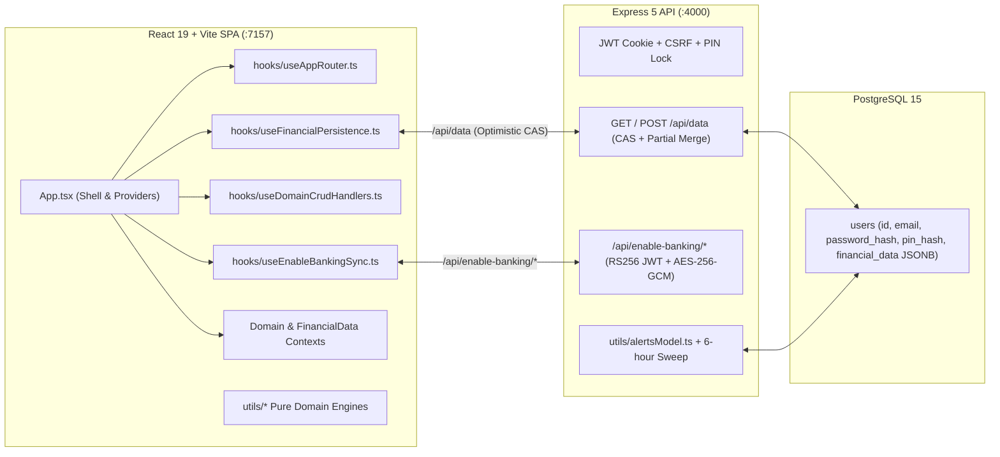

# Crystal v3.1 Architecture Overview

## 1. System Topology

Crystal is a self-hosted personal finance application designed for single-user or household deployment (1–5 users, `<50,000` transactions per user) on Umbrel or Docker Compose.

---

## 2. Frontend Architecture

### Root Shell (`App.tsx`) & Extracted Orchestration Hooks
- [`App.tsx`](../App.tsx): Root application shell, authentication/lock gate, theme/font/FX synchronization, and context provider composition.
- [`hooks/useAppRouter.ts`](../hooks/useAppRouter.ts): Manages URL routing (`parseRoute`, `pageToPath`), `popstate` listeners, route chunk preloading, and deep-linking (`/accounts/:id`, `/investments/:symbol`).
- [`hooks/useFinancialPersistence.ts`](../hooks/useFinancialPersistence.ts): Tracks per-slice dirty references against `savedSlicesRef`, debounces partial `POST /api/data` saves, executes 3-way merges on HTTP `409 Conflict` via [`utils/threeWayMerge.ts`](../utils/threeWayMerge.ts), and handles `beforeunload` keepalive flushes.
- [`hooks/useDomainCrudHandlers.ts`](../hooks/useDomainCrudHandlers.ts): Memoized (`useCallback`) CRUD handlers for all domain entities (`Account`, `Transaction`, `InvestmentTransaction`, `RecurringTransaction`, `FinancialGoal`, `Budget`, `Task`, `Warrant`, `Tag`, `BillPayment`, `Membership`, `Invoice`, `Prediction`, and category cascades).
- [`hooks/useEnableBankingSync.ts`](../hooks/useEnableBankingSync.ts): Manages PSD2 Open Banking bank discovery, consent creation, concurrent account fetching, incremental/full transaction sync, deduplication, and consent-expiry notifications.

### Context Providers (`contexts/`)
- [`contexts/DomainProviders.tsx`](../contexts/DomainProviders.tsx):
  - `PreferencesProvider`: `preferences`, `setPreferences`
  - `AccountsProvider`: `accounts`, `accountOrder`, `setAccountOrder`, `saveAccount`
  - `TransactionsProvider`: `transactions`, monotonic `digest`, `saveTransaction`, `deleteTransactions`
  - `WarrantsProvider`: `warrants`, `prices`
  - `InvoicesProvider`: `invoices`, `saveInvoice`, `deleteInvoice`
- [`contexts/FinancialDataContext.tsx`](../contexts/FinancialDataContext.tsx):
  - `CategoryContext`, `TagsContext`, `BudgetsContext`, `GoalsContext`, `ScheduleContext`
- [`contexts/InsightsViewContext.tsx`](../contexts/InsightsViewContext.tsx): Global analytics filter bar state (period duration, selected accounts, active goal projections).

### Pure Domain Calculation Engines (`utils/`)
All financial calculations live in pure, unit-tested TypeScript modules under `utils/`:
- [`utils.ts`](../utils.ts): Decimal-safe math (`big.js`), currency conversion (`convertCurrency`, `convertToMain`, `convertToEur`), `resolveAccountBalance`, `calculateAccountTotals`, and date parsing (`parseLocalDate`).
- [`utils/transactionChanges.ts`](../utils/transactionChanges.ts): Atomic transaction delta planner (`planTransactionChanges`, `applyTransactionChanges`, `applyBalanceChanges`).
- [`utils/forecastModel.ts`](../utils/forecastModel.ts) & [`utils/scheduleModel.ts`](../utils/scheduleModel.ts): Cashflow projection, recurring occurrence expansion, and safe-to-spend modeling.
- [`utils/investments.ts`](../utils/investments.ts): Chronological average-cost holdings, FIFO realized gains, and warrant valuation.

---

## 3. Backend & Persistence Architecture (`server/src/`)

- **Single-Row JSONB Document Store**: Each user's complete `FinancialData` state is stored in `users.financial_data` (`JSONB`) in PostgreSQL ([`server/src/database.ts`](../server/src/database.ts)).
- **Optimistic Concurrency Control (CAS)**:
  - Full and partial saves (`POST /api/data` in [`server/src/index.ts`](../server/src/index.ts)) compare `previousUpdatedAt` against `financial_data->>'lastUpdatedAt'` inside a `SELECT ... FOR UPDATE` transaction.
  - On mismatch, the server returns `409 Conflict` with `currentUpdatedAt`, triggering a client-side 3-way merge ([`utils/threeWayMerge.ts`](../utils/threeWayMerge.ts)).
- **Security Controls**:
  - `httpOnly` JWT session cookies (`crystal_token`) + double-submit CSRF cookie (`crystal_csrf` / `X-CSRF-Token`).
  - Optional server-enforced 4-digit PIN lock ([`server/src/lock.ts`](../server/src/lock.ts)) that blocks all `/api/*` data routes with HTTP `423 Locked` while locked.
  - AES-256-GCM encryption at rest ([`server/src/crypto.ts`](../server/src/crypto.ts)) for Enable Banking RSA private keys (`ENCRYPTION_SECRET` or `SHA-256(JWT_SECRET)`).
  - SSRF protection ([`utils/urlSafety.ts`](../utils/urlSafety.ts)) on outbound alert webhooks (Discord, Slack, Telegram, Gotify, ntfy).
