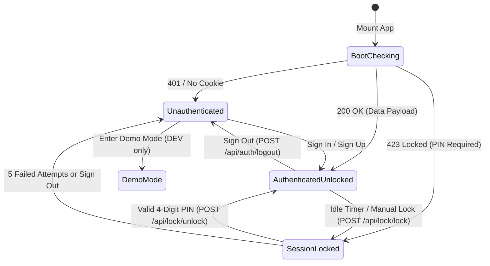
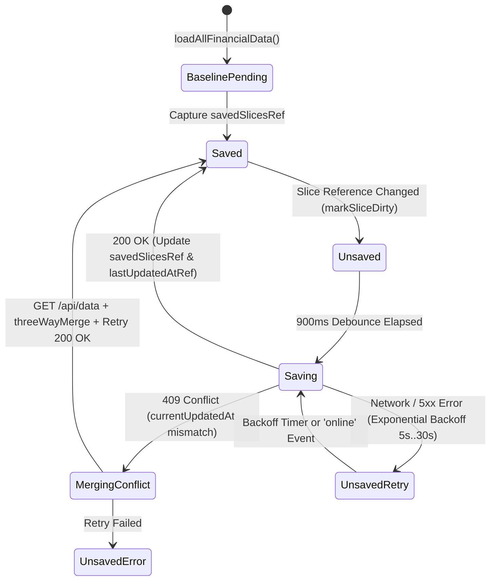
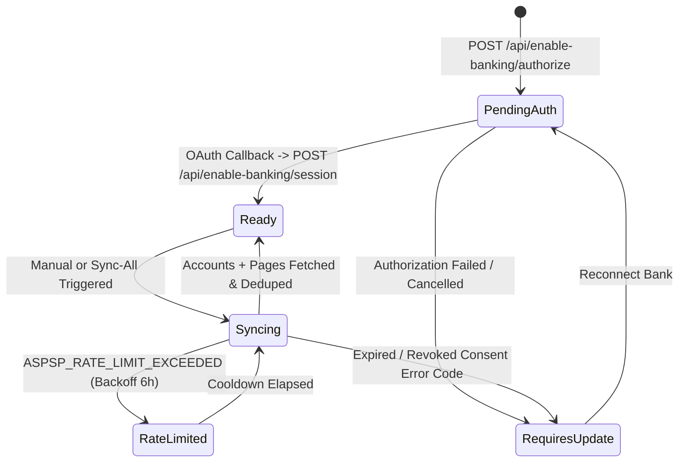

# Crystal State Machines Reference

This document maps the core state machines governing authentication, persistence, bank synchronization, and scheduled obligations in Crystal.

---

## 1. Authentication, Session & PIN Lock State Machine

**Owners**: [`hooks/useAuth.ts`](../hooks/useAuth.ts), [`server/src/lock.ts`](../server/src/lock.ts), [`App.tsx`](../App.tsx)

### Invariants
- When `isAuthenticated` is `true`, `isDemoMode` and `crystal_dev_mode_active` are forcibly cleared so live financial data is never written to browser dev storage.
- While in `SessionLocked` (`HTTP 423`), the server blocks all `/api/data` and `/api/enable-banking/*` endpoints; the client renders only [`components/LockScreen.tsx`](../components/LockScreen.tsx).

---

## 2. Client-Server Persistence & 3-Way Merge State Machine

**Owners**: [`hooks/useFinancialPersistence.ts`](../hooks/useFinancialPersistence.ts), [`utils/threeWayMerge.ts`](../utils/threeWayMerge.ts), [`server/src/index.ts`](../server/src/index.ts)

### Keyed Merge Rules ([`utils/threeWayMerge.ts`](../utils/threeWayMerge.ts))
- Standard entity arrays merge by `item.id`.
- `recurringTransactionOverrides` merges by composite key `${recurringTransactionId}::${originalDate}`.
- `priceHistory` (per-ISIN array) merges by `entry.date`.
- On a successful 409 retry, `savedSlicesRef.current` is updated with the **merged** slices (`mergedSlicesRef.current`), and `refreshFromServer()` adopts the merged server state if no newer local edits are pending.

---

## 3. Enable Banking Connection & Sync State Machine

**Owners**: [`hooks/useEnableBankingSync.ts`](../hooks/useEnableBankingSync.ts), [`pages/EnableBankingCallback.tsx`](../pages/EnableBankingCallback.tsx), [`server/src/index.ts`](../server/src/index.ts)

### Invariants
- `syncingConnectionIdsRef` prevents concurrent sync runs for the same `connectionId`.
- `status` is never persisted as `'pending'` during a routine sync so closing the browser mid-sync does not strand the connection.
- `transactionsRef.current` is updated synchronously inside `handleSaveTransaction`, ensuring sequential multi-bank syncs (`Sync All`) deduplicate against transactions imported by earlier banks in the same batch.

---

## 4. Recurring Obligation & Occurrence Lifecycle

**Owners**: [`utils/scheduleModel.ts`](../utils/scheduleModel.ts), [`utils/subscriptionsModel.ts`](../utils/subscriptionsModel.ts)

- **Series States**: `active` (`!pausedAt && (!endDate || endDate >= today)`), `paused` (`Boolean(pausedAt)`), `cancelled` (`endDate < today`).
- **Occurrence States**:
  - `upcoming`: `date >= today` and not yet posted or skipped.
  - `overdue`: `date < today` (within `OVERDUE_DAYS` window) and no matching ledger transaction (`recurringSourceId === series.id` or fuzzy date/amount match).
  - `posted`: Matched to a ledger transaction.
  - `skipped`: Matched to a `RecurringTransactionOverride` with `isSkipped: true`.
  - `expired`: Archived one-time `BillPayment` (`status === 'expired'`).
